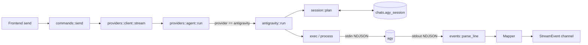

# Antigravity CLI provider

SlopChat can use Google's Antigravity CLI (`agy`) as a chat provider. Model refs look
like `antigravity/<slug>` and are usable in profiles, the palette and the model editor.
`agy` runs under the Google account the user has already signed into; SlopChat sends the
prompt on stdin and streams `agy`'s NDJSON output into the chat.

The core runner (`providers/antigravity::exec`) takes no `Channel`, store or `ChatRequest`,
so it can later back a non-chat deep-research tool.

```
Frontend send ─▶ commands::send ─▶ providers::client::stream ─▶ providers::agent::run
                                                                     │ provider == "antigravity"
                                                                     ▼
                                                     providers::antigravity::run
                                                       │ session::plan()  ── store: chats.agy_session
                                                       │ exec(opts, cancel, on_event)  ── spawns agy
                                                       │     stdout NDJSON ─▶ events::parse_line
                                                       │     AgyEvent ─▶ Mapper ─▶ StreamEvent ─▶ Channel
                                                       │ on SUCCESS: store session; emit Usage + Done
```

<details>
<summary>mermaid</summary>


</details>

## Requirements

- Install: `curl -fsSL https://antigravity.google/cli/install.sh | bash` (the binary lands at
  `~/.local/bin/agy`).
- Sign in: run `agy` once in a terminal. Sign-in is out of scope in-app.
- The binary must be ≥ 1.1.15 (`--input-format stream-json`); ≥ 1.2.16 is recommended.
  Settings shows the detected path, version and a refresh button.
- A Finder-launched macOS app does not inherit the shell `PATH`, so `~/.local/bin/agy` is
  probed explicitly before walking `PATH`.

## Invocation

```
agy --input-format stream-json --output-format stream-json \
    --model <slug> [--conversation <id>] --sandbox [--print-timeout <N>s]
stdin:  {"event":"user","message":{"content":"<prompt>"}}
```

- `--sandbox` is always on; `--dangerously-skip-permissions` never is. Shell tools headless
  cannot prompt for, so they are auto-denied.
- The process runs in an empty SlopChat-owned workspace: `~/.local/share/SlopChat/antigravity/workspace`.
- `--print-timeout` is `advanced.maxTurnSecs`; the process is hard-killed 10 s later.
- `--effort` is **not** passed: every slug returned by `agy models` already encodes effort
  (`…-high/-medium/-low/-thinking`), and `--model X --effort Y` is rejected. SlopChat's
  reasoning button therefore has no effect for this provider.

## Output events (confirmed against 1.2.16)

| Event | Fields | Use |
| --- | --- | --- |
| `init` | top-level `conversation_id`; nested `init{cwd, tools[], permission_mode, model?}` | conversation id |
| `step_update` | nested `{conversation_id, step_index, state, step_type, …}` | text, tools |
| `result` | nested `{conversation_id, status, response, error?, usage, denied_actions?}` | final answer + usage |

- `state` ∈ `ACTIVE`/`DONE`/`ERROR`; `step_type` ∈ `user_input`/`agent_response`/`tool`/`system_message`.
- Text arrives as `text_delta`; a `tool` step arrives `ACTIVE` then `DONE` (with
  `tool_info.output`, a short summary) or `ERROR` (with `tool_info.error.message`).
- There is no separate thinking step; `thinking_tokens` only appears in usage.

## Conversation resume

`agy`'s own conversation is resumed per chat (`--conversation <id>`). The id (plus a
fingerprint of the user turns) is stored in `chats.agy_session`. A fresh conversation is
seeded from the whole SlopChat history when the stored pointer no longer matches — for
example after an edit, a rewind, a retry, or a detour through another provider.

| Situation | Result |
| --- | --- |
| Normal follow-up | Resume |
| Edited / regenerated earlier message | Fresh |
| Retry last message | Fresh |
| Other provider for a turn, then back | Fresh |
| Model slug changed | Resume (a different `--model` is accepted) |
| Stored id unknown to `agy` | Fresh (re-seeded once) |

Only **user** messages are fingerprinted: SlopChat post-processes assistant text before
saving, so it would never match. A rejected resume id is not an error — `agy` warns on stderr
and silently starts a new conversation, so the provider detects the changed
`conversation_id` and re-seeds once.

## Isolation and permissions

- Empty workspace, `--sandbox`, never `--dangerously-skip-permissions`.
- Shell commands are auto-denied headless; the result comes back as `SUCCESS` with an empty
  `response` and `denied_actions`, which the empty-response guard turns into an error.
- Requests SlopChat sends that `agy` ignores: `temperature`, `tools`, `toolCalling`,
  `webSearch`/`webToggle`, `maxCompletionTokens`, the frequency/presence penalties, and the
  search/fetch budgets. `agy` uses its own tools and limits.
- `cost` is always `None` (the sign-in plan is not billed per token).

## Known `agy` quirks and defenses

- **Empty success (#1065):** `SUCCESS` with no streamed text and an empty `response` is
  reported as an error and no session is stored.
- **Silent resume miss:** see above.
- **Unknown model:** `status:ERROR` + exit 1 → the profile fallback is used.
- **Cancel:** `SIGINT` yields `context canceled`; SlopChat treats it as a stop and sends `Done`.
- **Missing binary / too old:** maps to the profile fallback; without one, a clear error.

## Troubleshooting

- **Not installed:** Settings shows “Not installed”; install `agy` and press Refresh.
- **Not signed in:** “Antigravity isn't signed in. Run `agy` once in a terminal and sign in.”
- **Too old:** update `agy` (≥ 1.1.15).
- **Timeout:** raise Advanced → max turn time; `agy` returns partial output when
  `--print-timeout` expires.
